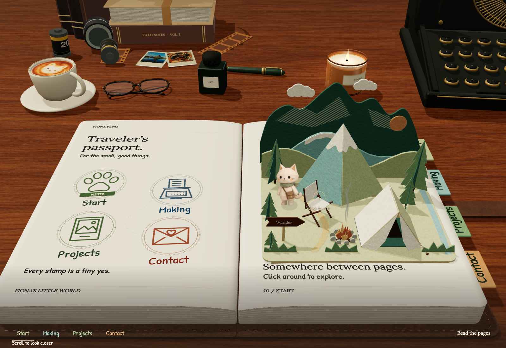
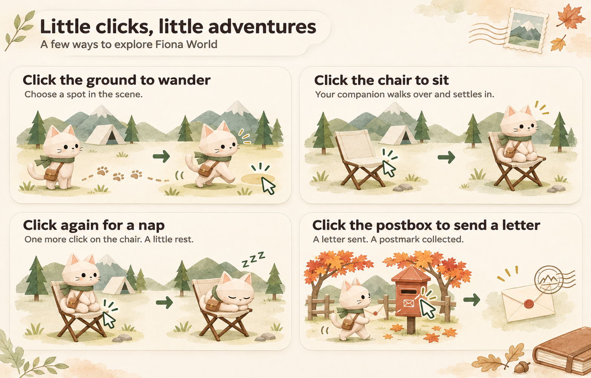

# Fiona World

A little world inside a traveler’s notebook.

Fiona World is Fiona Feng’s personal corner of the internet: a place for things I make, how they come together, and a few small adventures along the way.

On a warm writer’s desk sits a notebook with a brass clasp. Open it, and a cream-colored cat with a green scarf and a postal bag becomes your companion. Campsites, desert landscapes and a quiet station unfold from its paper pages.

[Open the notebook →](https://effy46.github.io/fiona-world/)

## Four chapters to wander through

**Start** — Your journey begins with a traveler’s passport and a tiny campsite. Let the cat explore, settle into a chair, or take a nap before turning the page.

**Making** — A peek at the ideas, references and experiments behind this world, with glimpses of how it changed along the way. Take a detour into the desert; there’s a letter arriving by balloon.

**Projects** — A collection of things I’m building, starting with [PawPal](https://github.com/effy46/PawPal), a desktop pet that keeps you company through the working day.

**Contact** — A little about me and where to find me. Stop by the station and collect a postmark before you go.

## Take your time

Look closer at the paper scenes, wander off the path, receive some airmail, and collect stamps in your passport.

## Small details along the way

Paper clouds drift over the campsite, the coffee gives off a little steam, and the candle flickers beside the book. The desert leaves an **AIRMAIL RECEIVED** mark after your delivery; the station leaves **POSTED** after your letter is sent.

Back in the passport, **VISITED** marks the chapters you’ve explored during this visit. In Projects, click the PawPal picture for a closer look; in Making, turn to the process notes to see the notebook’s earlier form.

There’s no hurry to reach the last page.
